<a href="./README.md">English</a> · <b>繁體中文</b>

<h1 align="center">嗨，我是黃朝隆 👋</h1>

<b>AI 研發工程師・軟體工程師</b> 
<i>為醫療、工業與企業場域打造可信賴的 LLM Agent。</i>

  

  
  
  
  

 

### 🙋 關於我

- 🤖 會先規劃、模擬、通過安全檢查才行動的 **LLM Agent**
- 🏥 **臨床 NLP** 與醫療去識別化（語音 + 病歷）
- 💬 企業內部每天使用的 **RAG 助理**
- 🎓 高科大電機工程系碩士

 

### 🏆 亮點

<table>
  <tr>
    <td align="center" width="25%">
      <h3>🥇</h3>
      <b>冠軍</b> 
      AI CUP 2025 
      <a href="https://reurl.cc/eQADzM">公告</a> · <a href="https://github.com/AUSTIN2526/med-voice-SHI-detector">程式碼</a> · <a href="https://link.springer.com/chapter/10.1007/978-981-92-2282-7_2">論文</a>
    </td>
    <td align="center" width="25%">
      <h3>🥈</h3>
      <b>亞軍</b> 
      AI CUP 2023・病歷去識別化 
      <a href="https://reurl.cc/XxyEGE">公告</a> · <a href="https://github.com/AUSTIN2526/DE-ID-AI-CUP-Trainer">程式碼</a> · <a href="https://link.springer.com/chapter/10.1007/978-981-97-7966-6_5">論文</a>
    </td>
    <td align="center" width="25%">
      <h3>📄</h3>
      <b>2 篇論文</b> 
      第一作者・Springer CCIS 
      <a href="https://link.springer.com/chapter/10.1007/978-981-92-2282-7_2">2025</a> · <a href="https://link.springer.com/chapter/10.1007/978-981-97-7966-6_5">2024</a>
    </td>
    <td align="center" width="25%">
      <h3>📚</h3>
      <b>4 本著作</b> 
      博碩文化・2023 – 2026 
      <a href="#books">見下方</a>
    </td>
  </tr>
</table>

<b>完整得獎紀錄與論文</b>

 

| 年份 | 獎項 | |
|:--:|---|---|
| 2025 | 🥇 冠軍，AI CUP 2025 醫病語音敏感個人資料辨識競賽 | [公告](https://reurl.cc/eQADzM) |
| 2024 | 🏅 佳作，第 16 屆 iThome 鐵人賽 AI & Data 組 | [公告](https://ithelp.ithome.com.tw/2024ironman/reward) |
| 2023 | 🥈 亞軍，AI CUP 2023 隱私保護與醫學數據標準化競賽 | [公告](https://reurl.cc/XxyEGE) |
| 2023 | 🏅 佳作，第 15 屆 iThome 鐵人賽 AI & Data 組 | [公告](https://ithelp.ithome.com.tw/2023ironman/reward) |
| 2023 | 🚀 16 強，Backdrop Build 國際線上黑客松 | [專案](https://backdropbuild.com/builds/ai-security-scanner) |
| 2022 | 🏅 佳作，第 14 屆 iThome 鐵人賽 AI & Data 組 | [公告](https://ithelp.ithome.com.tw/2022ironman/reward) |
| 2021 | 🎖️ 最佳人氣獎，高科大電機系實務專題 | |

**論文**
- *Temporal Subword De-Identification of Medical Speech for Privacy Protection Leveraging ASR and LLMs*，IW-DMRN 2025，Springer CCIS 2908 · [連結](https://link.springer.com/chapter/10.1007/978-981-92-2282-7_2)
- *Privacy Protection and Standardization of Electronic Medical Records Using Large Language Model*，IW-DMRN 2024，Springer CCIS 2148 · [連結](https://link.springer.com/chapter/10.1007/978-981-97-7966-6_5)

### 📚 著作 ・博碩文化

| | |
|:--:|---|
| **2026** 🆕 | 《LLM 開發實戰：從 10 行 Python 到 LoRA 微調》 · [購書](https://www.tenlong.com.tw/products/9786264144971) |
| **2025** | 《AI 程式設計、深度學習與 LLM 入門到精通》 · [購書](https://www.tenlong.com.tw/products/9786264143035) |
| **2024** | 《全面掌握生成式 AI 與 LLM 開發實務》 · [購書](https://www.tenlong.com.tw/products/9786263339682) · [程式碼](https://github.com/AUSTIN2526/learn-NLP-in-30-days-book-version) |
| **2023** | 《ChatGPT X Keras X PyTorch 全方位應用實踐指南》 · [購書](https://www.tenlong.com.tw/products/9786263336025) · [程式碼](https://github.com/AUSTIN2526/learn-AI-in-30-days-book-version) |

### 🎤 演講

[AI CUP 講座・中研院](https://www.youtube.com/watch?v=nmBCZmmNCpk) · [六角學院直播](https://hackmd.io/@hexschool/rJvO7JNskx) · iThome 鐵人講堂 [#1](https://itplus.ithome.com.tw/webinar-page/199) [#2](https://itplus.ithome.com.tw/webinar-page/252) · MedInfo 2025 Workshop

### 🛠️ 技術棧

  
   
  <code>Transformers</code> · <code>LoRA</code> · <code>RAG</code> · <code>Multi-Agent</code> · <code>Whisper ASR</code> · <code>FAISS</code>

